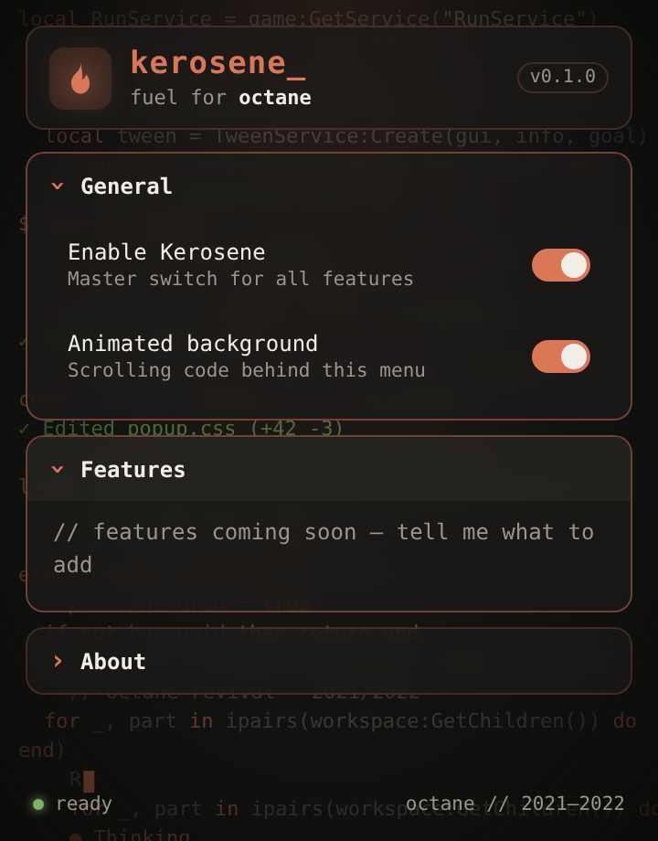

# kerosene

Fuel for [Octane](https://octane.wtf). Kerosene is a browser extension for the Octane Roblox revival (2021–2022 era).

## Features

- Popup with collapsible dropdown sections
- Animated Claude Code–style background: syntax-highlighted code scrolling behind the menu
- Settings that persist between sessions

## Install (Chrome / Edge / Brave / Opera)

1. Download this repo (**Code → Download ZIP**) and unzip it
2. Open `chrome://extensions` and turn on **Developer mode**
3. Click **Load unpacked** and select the `kerosene` folder
4. Pin Kerosene and click the flame icon
